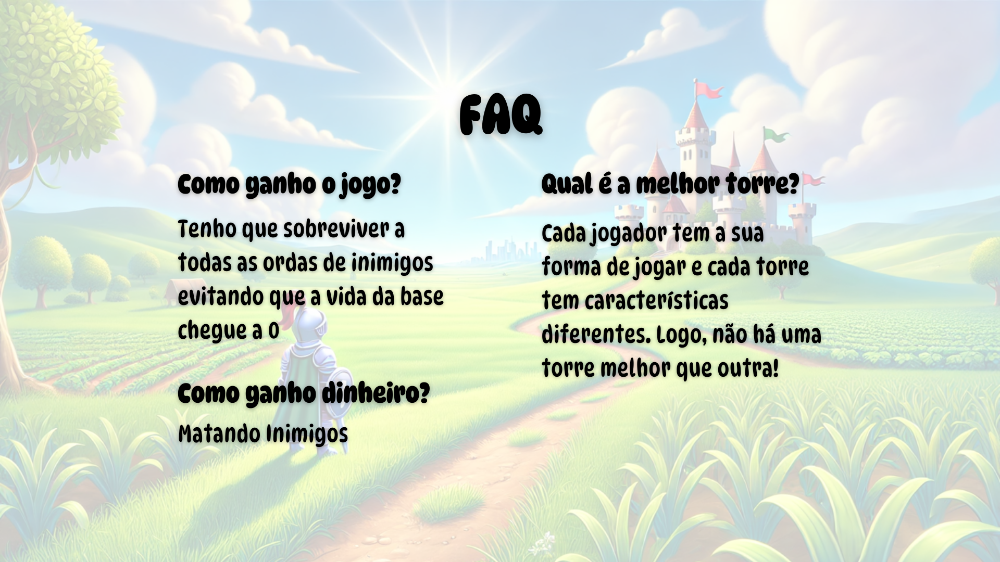
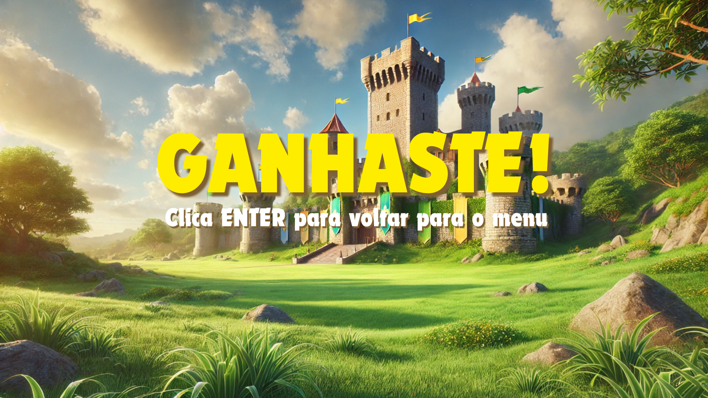
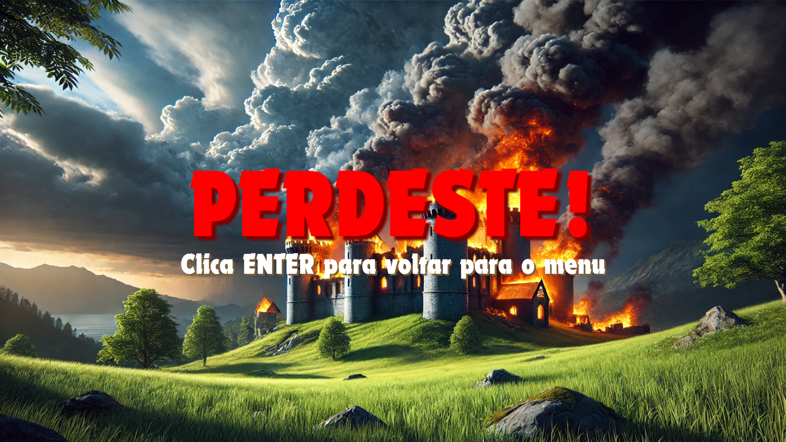
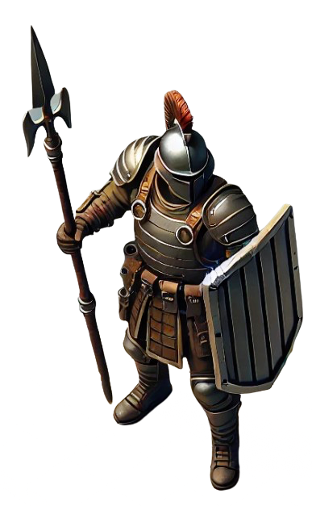
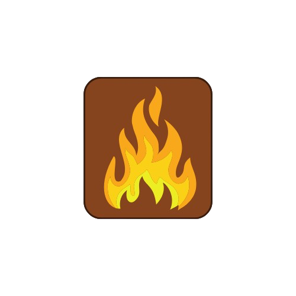
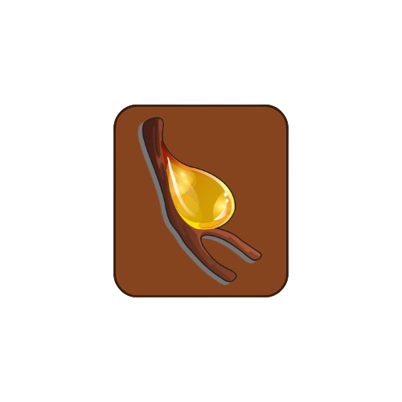

# 🏰 Immutable Towers

**Language:** Haskell (GHC2021) | **Graphics:** Gloss 1.13 | **Build:** Cabal 3.4 | **Testing:** HUnit

**Immutable Towers** is a 2D Tower Defense game built entirely in **Haskell** using the **Gloss** graphics library. Designed around purely functional state transitions, every frame tick, user interaction, projectile synergy, and enemy wave is modeled as an immutable transformation of the game world.

---

## 🎯 Core Idea

In traditional object-oriented game engines, entities mutate their internal coordinates, health bars, and timers in place. **Immutable Towers** takes the opposite approach: the entire game world is represented as an algebraic data structure (`ImmutableTowers` wrapping `Jogo`), and the game loop is driven by three pure functions passed to Gloss's `play` engine at **60 FPS**:

1. **Render (`ImmutableTowers -> Picture`)**: Purely projects the current game state into a composable 1920×1080 scene graph.
2. **Event Handling (`Event -> ImmutableTowers -> ImmutableTowers`)**: Transforms mouse clicks and keyboard presses into state transitions (menu navigation, shop purchases, grid-based tower placement).
3. **Time Step (`Float -> ImmutableTowers -> ImmutableTowers`)**: Advances portal wave timers, tower cooldowns, projectile status effects, enemy pathfinding, and win/loss conditions over elapsed time $\Delta t$.

Players defend their **Base** against waves of enemies spawning from **Portals** across 5 progressively challenging levels. By earning credits from defeated enemies, players purchase and strategically place **Fire**, **Ice**, and **Resin** towers on grass tiles to exploit elemental synergies and stop enemies before they breach the base.

---

## 💡 What This Project Demonstrates

- **Purely Functional Game Architecture**: Complete separation between core domain logic (`lib/`) and graphical/event presentation (`app/`), updating complex nested state without mutable variables or side effects outside asset loading.
- **Domain Modeling & Invariant Verification**: Rich Algebraic Data Types (ADTs) modeling terrains, portals, waves, towers, enemies, and projectiles (`LI12425.hs`), paired with formal state-invariant validators (`Tarefa1.hs`) that verify path reachability (DFS/BFS terrain traversal), non-overlapping entities, and valid status effect combinations.
- **Elemental Synergies & Status Effect Engine**: Compositional combat mechanics (`Tarefa2.hs` & `Tarefa3.hs`) featuring damage-over-time, movement immobilization, speed reduction, mutual cancellation, and duration amplification.
- **Continuous 2D Grid Pathfinding & Coordinate Mapping**: Smooth delta-time interpolation for enemy movement along dirt paths (`Terra`) with automatic 90° directional turns, plus bidirectional transformations between 2D matrix indices and centered 1920×1080 screen coordinates.
- **Automated Unit Testing**: Test suites built with `HUnit` (`test/`) validating game invariants, combat helpers, and temporal simulation ticks, with support for `doctest` and Cabal test coverage reports.

---

## 🎮 Gameplay & Mechanics

### 🗺️ Terrain Rules
The map is represented as a 2D matrix (`Mapa = [[Terreno]]`) with three distinct tile types:
- **Dirt (`Terra`)**: The path along which enemies march from **Portals** toward the **Base**. Neither towers nor water obstacles can occupy these tiles.
- **Grass (`Relva`)**: Constructible tiles where players can deploy defensive **Towers**.
- **Water (`Agua`)**: Decorative obstacles that cannot be traversed by enemies or built upon.

### 🗼 Towers & Elemental Projectile Synergies
Players spend **Credits** in the side-panel shop to deploy three specialized tower types:

| Tower | Cost | Damage | Range | Burst (`rajada`) | Cooldown (`ciclo`) | Projectile Effect |
| :--- | :---: | :---: | :---: | :---: | :---: | :--- |
| 🔥 **Fire Tower** (`torreFogo`) | 30 | 40 | 2.6 | 2 enemies | 5.0s | **Burn (`Fogo`, 8s)**: Deals continuous damage over time (4 HP/s). |
| ❄️ **Ice Tower** (`torreGelo`) | 20 | 30 | 2.1 | 3 enemies | 7.0s | **Freeze (`Gelo`, 4s)**: Completely halts enemy movement (`speed = 0`). |
| 🧪 **Resin Tower** (`torreResina`) | 20 | 10 | 2.1 | 4 enemies | 4.0s | **Slow (`Resina`, $\infty$)**: Permanently halves enemy movement speed. |

#### ⚡ Elemental Interactions
When an enemy is struck by a new projectile, active status effects interact dynamically (`atualizaProjeteis` in `lib/Tarefa2.hs`):
- **Fire + Ice $\rightarrow$ Mutual Cancellation**: Hitting a burning enemy with Ice (or a frozen enemy with Fire) cancels both effects immediately.
- **Fire + Resin $\rightarrow$ Combustion Synergy**: Hitting a resin-covered enemy with Fire (or applying Resin to a burning enemy) consumes the Resin and **doubles the remaining Fire duration**.
- **Same Element $\rightarrow$ Duration Stacking**: Consecutive hits of the same element stack their durations additively.

### 🕹️ Controls
- **Left Mouse Click**:
  - Navigate the **Main Menu**, **Level Selector** (Levels 1–5), and **FAQ** screen.
  - Click a tower icon in the right-hand **Shop Panel** (`Fogo`, `Gelo`, or `Resina`) to select it, then click any valid **Grass (`Relva`)** tile on the map to build it.
- **Enter Key**:
  - Return to the Main Menu from the **Victory**, **Defeat**, or **FAQ** screens.

---

## 🖼️ Visual Assets & Screens

### Menus & End-Game Screens

| Main Menu | FAQ / Instructions |
| :---: | :---: |
|  |  |

| Victory Screen | Defeat Screen |
| :---: | :---: |
|  |  |

### Entities & Elemental Projectiles

| Enemy Soldier | Fire Projectile (`Fogo`) | Ice Projectile (`Gelo`) | Resin Projectile (`Resina`) |
| :---: | :---: | :---: | :---: |
|  |  |  |  |

---

## 📂 Project Structure

```text
immutable-towers/
├── immutable-towers.cabal   # Cabal package configuration (library, executable, test-suite)
├── README.md                # Project documentation
├── lib/                     # Pure core game logic and domain models
│   ├── LI12425.hs           # Core ADTs: Jogo, Mapa, Terreno, Torre, Inimigo, Portal, Onda, Projetil
│   ├── Tarefa1.hs           # Game state invariants and map/entity validation (validaJogo)
│   ├── Tarefa2.hs           # Combat mechanics, range detection, projectile synergies, win/loss checks
│   └── Tarefa3.hs           # Temporal simulation: wave spawning, tower firing, enemy movement & DoT
├── app/                     # Graphical user interface and Gloss game loop
│   ├── Main.hs              # Application entry point, window setup (1920x1080 @ 60 FPS) & BMP loading
│   ├── ImmutableTowers.hs   # Top-level UI state, tower presets, and 5 pre-configured level maps
│   ├── Desenhar.hs          # Pure rendering pipeline (grid-to-screen projection, HUD, health bars)
│   ├── Eventos.hs           # Mouse and keyboard event handlers (menus, shop selection, tower placement)
│   └── Tempo.hs             # Frame delta-time integration connecting Gloss to Tarefa2 & Tarefa3
├── test/                    # Automated unit test suite (HUnit)
│   ├── Spec.hs              # Test runner entry point
│   ├── Tarefa1Spec.hs       # Unit tests for map and entity invariant validation
│   ├── Tarefa2Spec.hs       # Unit tests for range calculation, projectile hits, and end-game states
│   └── Tarefa3Spec.hs       # Unit tests for time-based updates (towers, enemies, and portals)
└── images/                  # Bitmap (.bmp) sprites for towers, enemies, projectiles, HUD, and menus
```

### Module Breakdown

| Layer | Module | Responsibility |
| :--- | :--- | :--- |
| **Domain (`lib/`)** | `LI12425` | Defines all core types (`Jogo`, `Base`, `Portal`, `Onda`, `Torre`, `Inimigo`, `Projetil`, `Terreno`) and random seed helpers. |
| **Validation (`lib/`)** | `Tarefa1` | Implements `validaJogo`, verifying portal-to-base path connectivity on `Terra`, valid entity placements, non-overlapping positions, and projectile compatibility. |
| **Combat & Rules (`lib/`)** | `Tarefa2` | Implements `inimigosNoAlcance`, `atingeInimigo`, `atualizaProjeteis` (elemental synergies), `ativaInimigo`, and game termination predicates (`terminouJogo`, `ganhouJogo`, `perdeuJogo`). |
| **Simulation (`lib/`)** | `Tarefa3` | Implements `atualizaJogo`, orchestrating portal wave progression (`atualizaPortais`), tower cooldowns & multi-target bursts (`atualizaTorres`), continuous enemy movement (`moverInimigos`), and active status effects (`aplicaEfeitos`). |
| **Presentation (`app/`)** | `Main`, `Desenhar`, `Eventos`, `Tempo`, `ImmutableTowers` | Connects the pure simulation to `Graphics.Gloss`, managing screen states (`Menu`, `EscolherNivel`, `JogoAtivo`, `Final`, `Fq`), coordinate transformations, and level definitions (`jogo1`–`jogo5`). |

---

## 🚀 Getting Started

### Prerequisites
- **GHC** (Glasgow Haskell Compiler, supporting `GHC2021` / `base ^>= 4.17.2.1`)
- **Cabal** (`>= 3.4`)
- OpenGL / GLUT system libraries (required by `gloss` for window rendering)

### Build & Run the Game
Run the executable directly from the project root directory (so relative paths to `images/*.bmp` resolve properly):

```bash
cabal run immutable-towers --verbose=0
```

### Interactive GHCi REPL
To inspect or experiment with individual functions in the Haskell interpreter:

```bash
cabal repl
```

### Run Unit Tests & Coverage
Execute the `HUnit` test suite for Tasks 1, 2, and 3:

```bash
cabal test
```

To generate an HPC test coverage report:

```bash
cabal test --enable-coverage
```

### Generate Documentation
Build HTML API documentation from the Haddock annotations across all modules:

```bash
cabal haddock
```

---

## 👥 Authors & Academic Context

Developed as part of the **Laboratórios de Informática I (LI1)** course in the Bachelor's degree in Informatics Engineering at the **University of Minho (UMinho)**, academic year 2024/2025:

- **Ricardo Filipe Lopes Soares** (`a110585@alunos.uminho.pt`)
- **Francisco da Cunha Carvalho** (`a110551@alunos.uminho.pt`)
